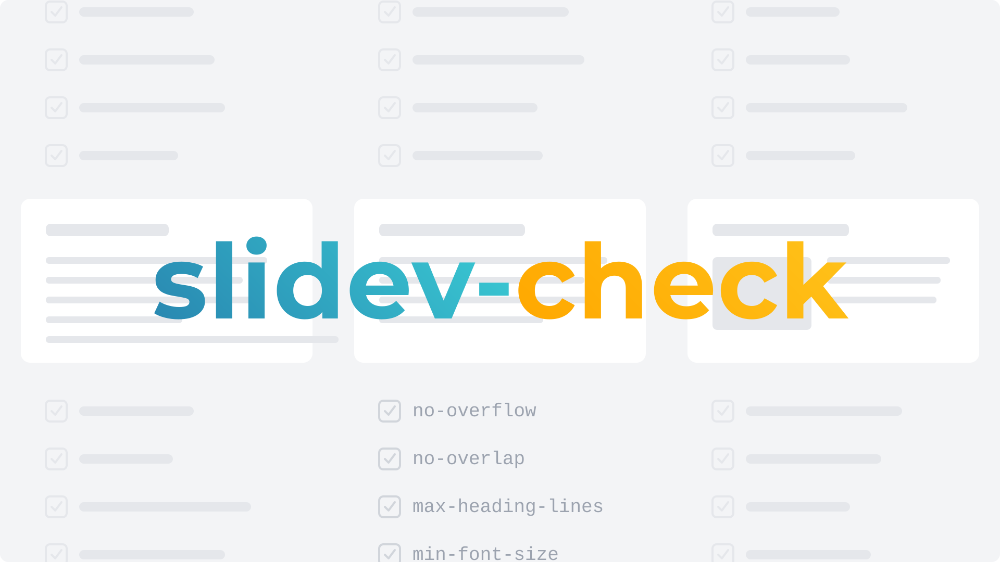
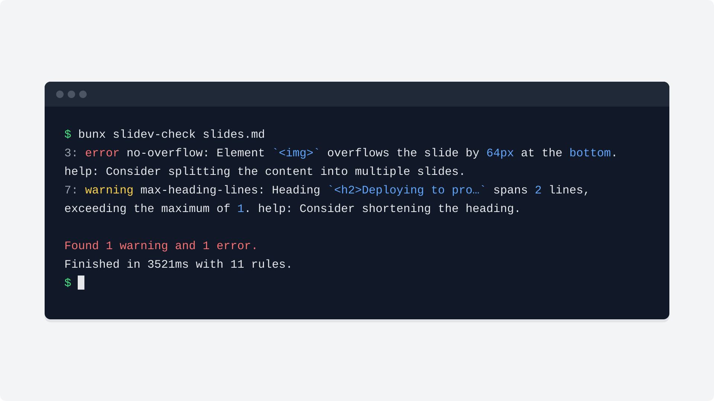

# slidev-check

[](https://www.npmjs.com/package/slidev-check)
[](https://www.npmjs.com/package/slidev-check)
[](https://github.com/WillBooster/slidev-check/actions/workflows/test.yml)
[](https://github.com/semantic-release/semantic-release)
[](https://github.com/WillBooster/shared/tree/main/packages/wbfy)



Audits the _rendered_ output of a [Slidev](https://sli.dev) deck and reports layout and content guideline problems, linter-style.

It is not a static analyzer: the deck is rendered by Slidev's own dev server (the same code path as `slidev export`) inside headless Chromium, and rules inspect the resulting DOM and geometry.

## Usage



```sh
bun add -d slidev-check                      # @slidev/cli and playwright-chromium are peer dependencies
bunx playwright-chromium install chromium    # once, if Chromium is not installed yet
bunx slidev-check slides.md
```

The deck is rendered with the `@slidev/cli` and theme installed in _your_ project, so the checked output matches what `slidev` itself shows.

Nothing is printed when no rule is violated. Otherwise each violation is reported with its location, cause, and a `help:` suggestion, and the exit code is `1` if any errors are found. Warnings alone keep exit code `0`:

```
3: error no-overflow: Element `<div.absolute>wide` overflows the slide by 220px at the right. help: Consider splitting the content into multiple slides.

Found 0 warnings and 1 error.
Finished in 3521ms with 11 rules.
```

Options: `--theme <name>`, `--wait <ms>`, `--timeout <ms>`, `--json`, `--fix`.

`--fix` rewrites the slide files with the fixes that rules attach to their findings and reports what remains (with `--json`, as `{ "fixed": N, "violations": [...] }`). Currently `optimal-zoom` provides fixes: for an element with an inline `zoom` style (typically a `<div style="zoom: 0.8">` around the whole slide body), it finds the largest zoom at which the content still keeps a margin (one text line by default) above the slide bottom and within the slide width, warns when the declared zoom is smaller (the content could be larger) or larger (the content is too tight, sticks out, or overflows; a zoom above 1 that still keeps the margin is left alone), and `--fix` replaces the declared value with the optimal one. Several wrappers on one slide are optimized in document order, so their fixes are consistent with each other. A slide without a wrapper whose content is too tight at zoom 1 is reported with the wrapper to add.

Add `data-slidev-check-ignore` to an element to exclude it (and its descendants) from all rules.

## Custom rules

Rules come from three sources, run in this order:

1. The built-in rules (`allRules`).
2. The rules of the deck's theme. When the theme package has a `./slidev-check` entry in its `package.json` `exports`, slidev-check imports it and runs its default export. A deck using the theme needs no configuration.
3. `rules` of the `check` API.

```json
{
  "name": "slidev-theme-example",
  "exports": { "./slidev-check": "./slidevCheck.ts" }
}
```

A rule (`Rule` from `slidev-check`) has:

- `id`: unique across all three sources.
- `description`.
- `defaultSetting`: a severity (`'error'`, `'warn'`, or `'off'`), or `[severity, options]`. The rule receives the options as `context.options`.
- `check(context)`: called once with the page, the canvas size, the options, and every visible slide (`slides`: location, markdown source, and the CSS selector of its container). It returns findings, each naming its `slide`, with `message`, `help`, and an optional `fix`.

`perSlide(fn)` builds `check` from a function that checks one slide at a time and returns findings without `slide`. The built-in rules use it. Its slides are checked one after another; implement `check` directly to compare slides or to run slow per-slide work concurrently.

Inside `page.evaluate`, `globalThis.slidevCheck` provides the helpers the built-in rules use (`BrowserHelpers`). They exclude ignored and hidden content the same way for every rule:

- `isChecked(element)` is false for hidden elements and for elements inside `[data-slidev-check-ignore]`. It does not look at descendants.
- `checkedText(element)` returns the text of the element's descendants that pass `isChecked`.

slidev-check cannot filter what a rule reads from the page. A rule must pass every element it inspects through `isChecked` and read text with `checkedText`.

```ts
import { perSlide, type Rule, type SlideFinding } from 'slidev-check';

const noTodo: Rule = {
  id: 'example/no-todo',
  description: 'Slides must not contain TODO.',
  defaultSetting: 'warn',
  check: perSlide(({ page, containerSelector }) => page.evaluate(findTodos, containerSelector)),
};

function findTodos(containerSelector: string): SlideFinding[] {
  const { checkedText, describe, isChecked } = globalThis.slidevCheck;
  return [...document.querySelectorAll(`${containerSelector} .slidev-layout p`)]
    .filter((p) => isChecked(p) && checkedText(p).includes('TODO'))
    .map((p) => ({ message: `\`${describe(p)}\` contains TODO.`, help: 'Consider resolving it.' }));
}

export default [noTodo] satisfies Rule[];
```

`settings` of the `check` API overrides settings by `id`. A bare severity keeps the rule's default options; a `[severity, options]` pair merges the options over them. A duplicate `id`, or a setting for an unknown `id`, fails the check before the deck is rendered.

## Content guidelines

The following rules run by default as warnings, based on the [slide guidelines](https://github.com/WillBooster/agentic-workflows/pull/665):

| Rule                  | Limit                                       |
| --------------------- | ------------------------------------------- |
| `max-body-characters` | 350 non-whitespace characters per slide     |
| `max-list-depth`      | 2 nested list levels                        |
| `max-table-rows`      | 8 visible rows per table, including headers |
| `min-list-items`      | 2 visible items per list                    |
| `min-font-scale`      | 0.6× the theme's default text size          |
| `min-heading-scale`   | 1× the theme's default slide heading size   |

Character counts include prose, lists, code, and table text inside `.slidev-layout`, excluding headings, hidden content, and elements marked `data-slidev-check-ignore`. Unicode grapheme clusters count as single characters, including emoji and combining marks. Laid-out ignored or hidden text preserves character boundaries without contributing to the count. Inline markup does not count text twice. Whitespace, formatting-only controls, and DOM separators do not add characters. Theme content outside the layout and speaker notes are not counted.

Custom layouts must mark their content root with `class="slidev-layout"`. Visibility checks respect display, visibility, opacity, and content-visibility; visible text inside boxless `display: contents` wrappers is counted. Text skipped by `content-visibility: hidden` is excluded; the same declaration on elements where it has no effect does not hide visible text. Text clipped or clamped by CSS still counts. Use `data-slidev-check-ignore` for intentionally excluded content. Text metrics inspect HTML/SVG text nodes directly present in the document. SVG resource definitions and text instantiated through `<use>` are outside the count, as are shadow-root text and direct native MathML; these require manual review. Slidev's standard KaTeX HTML rendering is counted.

`max-table-rows` identifies each over-limit table separately. Structure budgets count visible row and list-item boxes, including empty boxes and boxes whose contents are skipped by `content-visibility: hidden`. A hidden row or list item becomes countable only through measurable DOM text that passes the visibility checks; an empty visible descendant is insufficient. Graphic-only visibility overrides inside hidden structures require manual review.

`min-list-items` counts the direct visible items of each `<ul>`/`<ol>` in the layout, so a nested list with one item is reported too. Lists inside table cells are skipped because a column often keeps the same shape in every cell, and so are parts of a numbered list that Markdown split around other content (sibling `<ol>`s whose `start` continues the previous part).

`min-font-scale` and `min-heading-scale` compare the rendered size of text (its font size multiplied by every `zoom`, `scale`, and `transform` scale above it) with its size when the slide author's scaling is removed: inline `zoom`, `font-size`, `scale`, and `transform` styles (including Slidev's `<Transform :scale>`), the `zoom` frontmatter, and the slide's `<style>` blocks. Styles of the theme, Slidev, the deck's global stylesheets, and utility classes such as `text-sm` belong to the default. `min-font-scale` reports each shrunk region once, at its outermost shrunk element (typically a zoom wrapper). `min-heading-scale` checks the text of the first heading of each slide, including inline markup inside it, excluding the deck title on cover and intro layouts as `max-heading-lines` does, so a heading shrunk to fit on one line is reported even when `max-heading-lines` no longer is. Verbatim source quotations, which the guideline allows to be shrunk further, need `data-slidev-check-ignore`.

These warnings suggest shortening or splitting content and do not provide automatic fixes. The guideline's ten-line visual budget and semantic requirements need manual review. Existing layout rules still check geometry, and `min-font-size` retains its 14 CSS pixel default rather than the guideline's 18pt.

## Development

```sh
bun run check   # type check
bun test
```

## License

Apache License &copy; WillBooster Inc.
